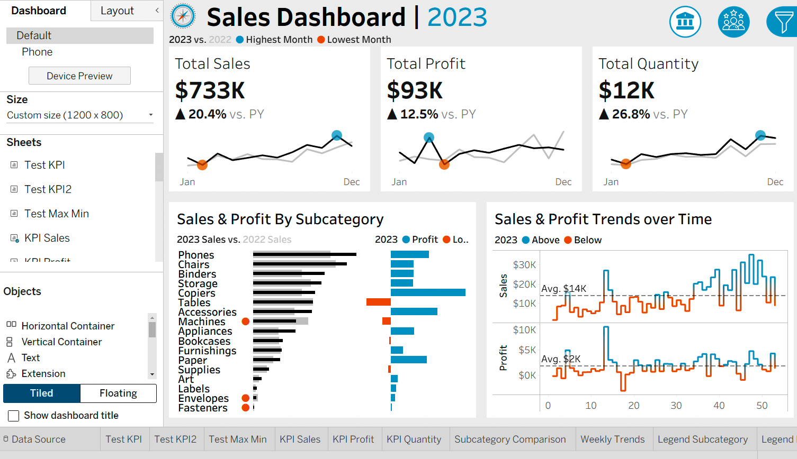
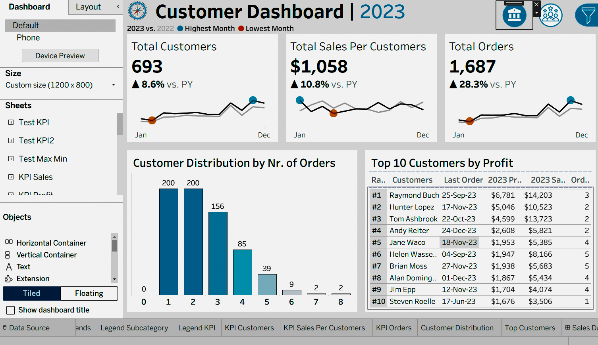

# Sales & Customer Dashboards (Tableau)

An interactive Tableau project with two dashboards, **Sales** and **Customer**, built on a retail orders dataset covering January 2020 to December 2023. It tracks year-over-year performance of sales, profit, orders, quantity and customers, and shows which customers, sub-categories and time periods drive the results.

## Preview

### Sales Dashboard


### Customer Dashboard


## Dashboards

| Dashboard | What it shows |
|-----------|---------------|
| **Sales Dashboard** | KPI cards for Sales, Profit, Quantity and Orders with current-year vs previous-year change, weekly trends, and sub-category comparison |
| **Customer Dashboard** | KPI cards for Customers and Sales per Customer, customer distribution, and top customers |

### Key features
- **Year selector** (`Select Year` parameter) that drives all KPIs
- **Year-over-year comparison**: current year (CY) vs previous year (PY) with `% Diff` calculations for sales, profit, orders, quantity, customers and sales per customer
- **Min/Max highlighting** on trend views
- **Weekly trend** analysis
- **Navigation icons** and a show/hide filter panel for a clean dashboard layout

## Dataset

Four CSV files, joined into a single data source named `Sales DataSource`:

| File | Rows | Columns |
|------|------|---------|
| `Orders.csv` | 9,994 | Row ID, Order ID, Order Date, Ship Date, Ship Mode, Customer ID, Segment, Postal Code, Product ID, Sales, Quantity, Discount, Profit |
| `Customers.csv` | 793 | Customer ID, Customer Name |
| `Location.csv` | 632 | Postal Code, City, State, Region, Country/Region |
| `Products.csv` | 1,894 | Product ID, Category, Sub-Category, Product Name |

**Relationships**
- `Orders.Customer ID` to `Customers.Customer ID`
- `Orders.Postal Code` to `Location.Postal Code`
- `Orders.Product ID` to `Products.Product ID`

**Dataset at a glance**
- Order period: 2020-01-03 to 2023-12-30
- 5,009 unique orders from 793 customers
- Segments: Consumer, Corporate, Home Office
- Ship modes: Standard Class, Second Class, First Class, Same Day
- Regions: Central, East, South, West (United States)

> **Format notes:** the CSVs are **semicolon-delimited** (`;`), dates are **day/month/year** (`dd/mm/yyyy`), and `Products.csv` is not UTF-8 (read it as `latin-1`).

## Repository structure

```
.
├── README.md
├── .gitignore
├── tableau/
│   └── Sales_Customer_Dashboards.twbx
├── data/
│   ├── Customers.csv
│   ├── Location.csv
│   ├── Orders.csv
│   └── Products.csv
└── images/                # dashboard screenshots (optional)
```

## How to open

1. Install [Tableau Desktop](https://www.tableau.com/products/desktop) or the free [Tableau Public](https://public.tableau.com/) desktop app.
2. Clone this repository.
3. Open `tableau/Sales_Customer_Dashboards.twbx`. The data extract is packaged inside the workbook, so it works without the CSVs.
4. To refresh from source, go to **Data > Sales DataSource > Edit Data Source** and re-point the four tables to the files in `data/`.

## Tools

- Tableau (packaged workbook, `.twbx`, built with Tableau 2023.2)
- CSV source data

## Author

**Muli Brian Mark**
Software Engineering (Diploma), Zetech University
GitHub: [@your-username](https://github.com/your-username)

## License

Add a license of your choice (e.g. MIT) or remove this section. If the dataset comes from a public source, credit it here.
